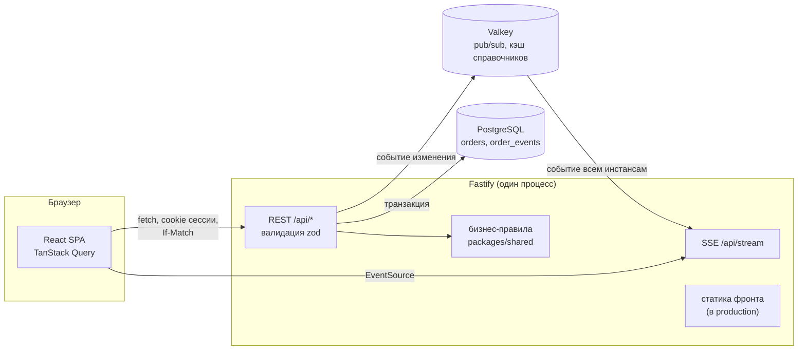
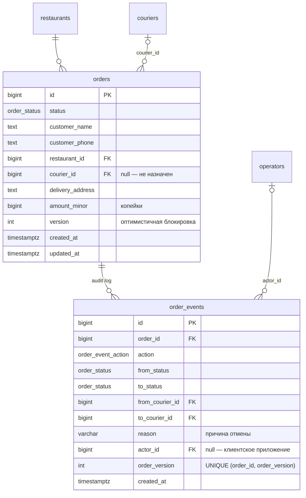
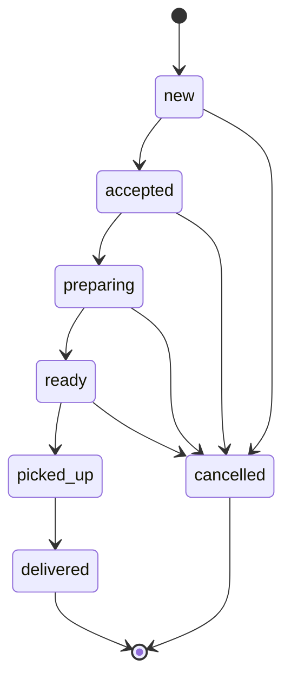
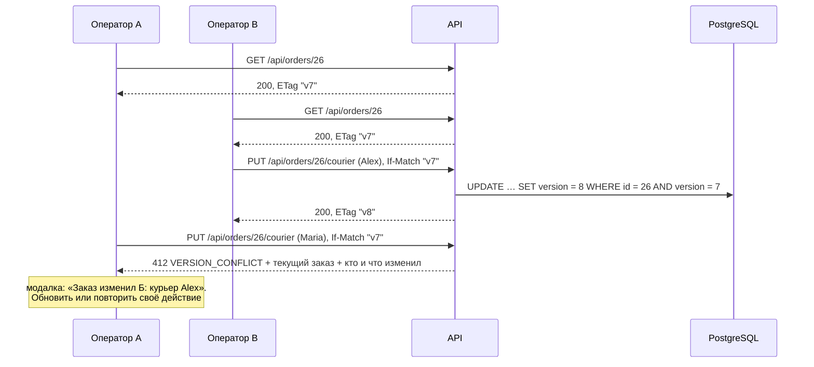

# Foodster Ops — админка заказов

Тестовое задание Foodster (Fullstack Developer): интерфейс операционной команды для просмотра и управления заказами ресторанов — статусы, курьеры, отмена, история изменений, обнаружение конфликтов при одновременной работе.

**Стек:** TypeScript везде · API — Node.js 24, Fastify 5, zod 4, Drizzle ORM, PostgreSQL 18, Valkey (необязателен) · фронт — React 19, Vite, TanStack Router и Query, Mantine · тесты — Vitest (интеграционные с настоящей БД, unit, тесты фронта в jsdom).

## Быстрый старт

Нужны Node.js ≥ 24.15 и Docker (Compose v2).

```bash
npm install
npm run dev-db:setup   # Postgres + Valkey в Docker, миграции, seed
npm run dev            # API — порт 3000, фронт — порт 5173
```

Откройте фронт (`localhost:5173`), выберите любого оператора и войдите. Пароль общий для всех операторов; при локальном запуске он показан на странице входа.

- Swagger UI: `localhost:3000/api/docs`
- Seed: 20 ресторанов, 20 курьеров, 20 операторов, 200 заказов во всех статусах, у части курьеров уже по 3 активные доставки — чтобы проверить лимит.
- Настройки берутся из `.env.example`; свои значения можно положить в `.env` (он переопределяет пример). Порты Docker меняются там же.
- `npm run dev-db:down` — остановить контейнеры, `npm run dev-db:reset` — удалить их вместе с данными.

## Тесты

```bash
npm run test-db:setup  # отдельный Postgres для тестов (порт 5433) и Valkey
npm test               # shared, API, фронт
npm run check          # типы, ESLint, Prettier
```

- **API — интеграционные тесты на настоящем Postgres.** Каждый тестовый файл получает свою базу, созданную из шаблона с применёнными миграциями (`CREATE DATABASE … TEMPLATE`), поэтому файлы идут параллельно и не мешают друг другу. Проверяются: допустимые и запрещённые переходы статусов, конкурентные изменения (412, гонка двух назначений одному курьеру), лимит активных доставок, фильтры, поиск и сортировка, формат ошибок, сессии, ограничение частоты входа, события SSE через Valkey.
- **shared — unit-тесты** конечного автомата статусов и бизнес-правил (их же использует фронт).
- **CI** — GitHub Actions (`.github/workflows/ci.yml`) на каждый пуш в `master` и pull request: `npm run check`, тестовая БД тем же `docker-compose.yml`, `npm test`, production-сборка.
- **Фронт — Vitest + jsdom + Testing Library:** правила действий, синхронизация поиска с адресом, конфликт версий и «Повторить», панель действий, поток SSE.

## Архитектура

Монорепозиторий на npm workspaces:

```
apps/api         REST API (Fastify): модули orders, couriers, restaurants, operators, auth, stream
apps/web         SPA (React)
packages/shared  общий код API и фронта: статусы, переходы, бизнес-правила, схемы zod, коды ошибок
```



- **Общие правила.** Переходы статусов и проверки (`checkStatusChange`, лимит курьера, когда можно менять курьера) лежат в `packages/shared`: API применяет их как закон, фронт — чтобы показывать только допустимые действия. Последняя линия защиты — CHECK-ограничения в БД (например, `picked_up`/`delivered` без курьера невозможны).
- **Слои API:** маршрут (схема zod → валидация и OpenAPI) → сервис/команда (транзакция, правила) → репозиторий (Drizzle). Ошибки — `application/problem+json` по RFC 9457 с машинным `code`, по которому фронт выбирает текст.
- **Valkey необязателен.** С ним события об изменениях доходят до всех инстансов API и кэшируются справочники; без него события остаются внутри процесса, справочники читаются из БД.

### Модель данных



Каждое изменение заказа в одной транзакции повышает `version` ровно на 1 и пишет ровно одну запись в `order_events` (`created`, `status_changed`, `courier_assigned`, `courier_changed`, `courier_unassigned`, `cancelled`) — с автором, старым и новым статусом/курьером. Это и есть audit log, который показывает карточка заказа.

### Статусы



- Только вперёд по одному шагу; отменить можно до `picked_up`, причина обязательна — не короче 30 символов.
- Забрать заказ (`picked_up`) можно только с назначенным курьером. Курьера можно назначить, сменить или снять, пока заказ не забран.
- У курьера не больше 3 активных доставок (`ready`, `picked_up`). Лимит проверяется при назначении **и** при переходе в `ready`: иначе его можно обойти сменой статуса.

### Конкурентные изменения

Оптимистичная блокировка по версии заказа. Карточка приходит с `ETag: "v7"`, каждое изменение отправляется с `If-Match: "v7"`:



- Без `If-Match` изменение отклоняется (428): иначе конфликт нечем обнаружить.
- Запись — compare-and-set по версии в той же транзакции, что и проверка правил; запоздавший запрос не затирает чужое изменение даже между чтением и записью.
- Гонка **по курьеру** (два оператора одновременно назначают ему два разных заказа) версией заказа не ловится — строка курьера блокируется (`SELECT … FOR NO KEY UPDATE`), и проверки лимита идут по очереди.
- Живые обновления: после каждого изменения API рассылает событие через SSE (Server-Sent Events), открытые списки и карточки перезапрашивают данные, а карточка показывает «Заказ только что изменили» с автором.

### Прочие решения

- **Вход.** В задании аутентификация не требуется, но audit log должен знать, кто сделал действие, а сценарий конфликта — различать двух операторов. Поэтому лёгкий вход: выбор оператора из списка и общий пароль; сессия — JWT в httpOnly-cookie. Вход ограничен 5 попытками в минуту с IP (проверка пароля через scrypt намеренно медленная).
- **Список.** Фильтры по нескольким статусам и ресторанам, сортировка (дата создания/изменения, сумма), offset-пагинация, всё состояние — в адресе страницы. Поиск по адресу с опечатками — `pg_trgm` (`word_similarity`, GIN-индекс) плюс варианты для неверной раскладки и транслитерации.
- **Деньги** — целые копейки (`amount_minor`), без плавающей точки.
- **Фронт:** состояния загрузки, пустого списка и ошибок, понятные тексты бизнес-ошибок и конфликтов, адаптивная вёрстка, доступность (роли, фокус, подписи), разбиение кода по страницам.

## Деплой

Стенд — на Render (бесплатный план); адрес и пароль операторов передаются отдельно. Бесплатный сервис засыпает после 15 минут без запросов, и первое открытие занимает около минуты.

Один web service: API отдаёт и собранный фронт (один адрес — cookie и SSE без CORS). Плюс Render Postgres и Render Key Value.

```bash
npm ci --include=dev && npm run build   # Build Command: фронт (Vite) и API (esbuild)
exec npm start -w @foodster/api          # Start Command: миграции → seed (если SEED_ON_START=true) → сервер
```

Переменные окружения (env group): `NODE_ENV=production`, `DATABASE_URL`, `REDIS_URL` (необязательна), `JWT_SECRET` (≥ 32 символов), `SEED_ON_START=true` для первого заполнения, `SEED_OPERATOR_PASSWORD` (пароль операторов на стенде — секрет, на странице и в репозитории его нет), `TRUST_PROXY` (адреса прокси Render — по ним определяется IP клиента для ограничения входа). Health check: `/api/health`.

## AI-инструменты

Использовался только **Claude Code** (Anthropic) — на всех этапах:

- разбор задания, поиск противоречий и пробелов, план работ;
- проектирование API, модели данных и механизма конфликтов;
- код API и фронта, миграции, seed;
- тесты (интеграционные, unit, фронт) и проверка их силы намеренными поломками кода;
- ревью каждого изменения отдельными агентами и проверка интерфейса в браузере (headless Chrome);
- документация и этот README.

Решения по архитектуре и поведению принимал разработчик; изменения проходили ревью, тесты и ручную проверку.

## Лицензия

Код проекта распространяется по лицензии AGPL-3.0-only (файл `LICENSE`).

## Товарные знаки

Название, логотип (знак-молния) и фирменный цвет Foodster принадлежат правообладателю или используются им. В проекте они использованы только для демонстрации в рамках тестового задания. Лицензия AGPL-3.0-only этого репозитория на них не распространяется и прав на их использование не даёт.

Приложение не является официальным сервисом Foodster.

Файлы с фирменными элементами: `apps/web/src/components/Logo.tsx`, `apps/web/public/favicon.svg`, палитра в `apps/web/src/theme.ts`, название и цвет в `apps/web/index.html` (`<title>`, `theme-color`). Шрифты Onest и Inter — открытые (SIL OFL 1.1), к фирменным элементам не относятся.
